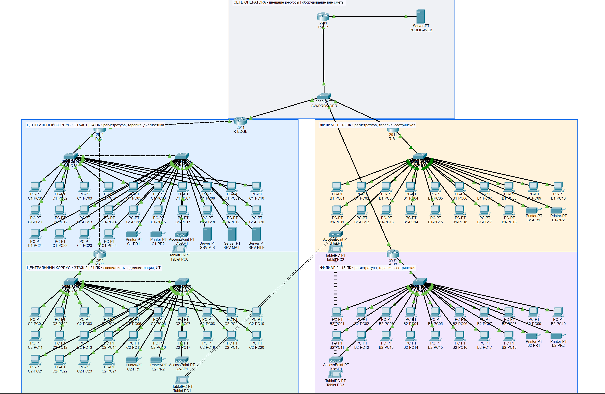
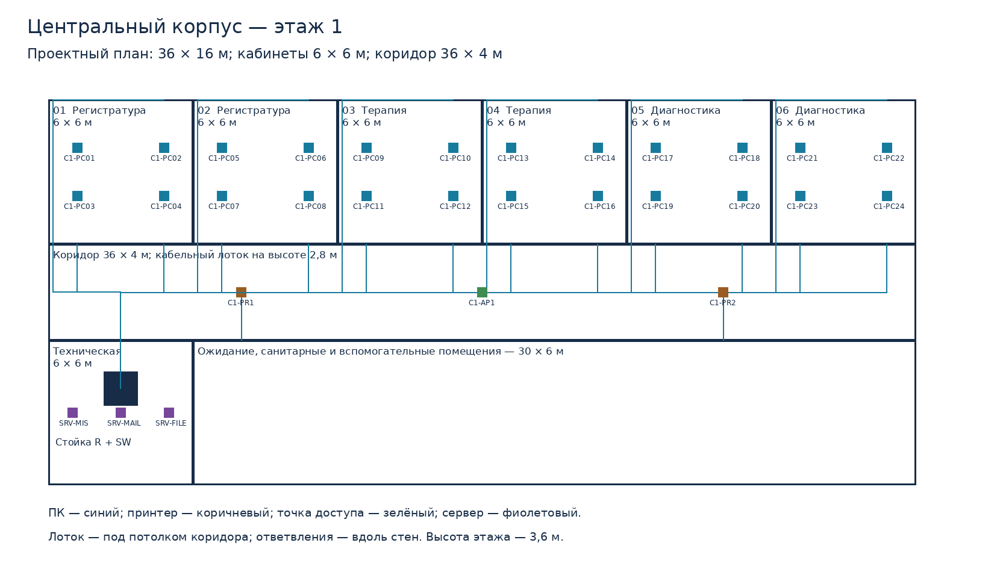

# Как защитить проект сети поликлиники

Пособие к ДЗ1 по ИТС • вариант 8 • Устинов Илья Максимович, ИУ10-59

Версия от 20 октября 2026 года. Основано на текущей презентации из 18 слайдов, расчётах и модели L1–L2. Материал предназначен для подготовки к защите; добавлять его к сдаваемому отчёту не требуется.

## 1. Что нужно понять прежде всего

Твоя работа — предварительный проект сети городской поликлиники. Это ответ на вопросы: кому нужна связь, для каких задач, сколько будет устройств, как их соединить, где провести кабель, какая скорость нужна и сколько примерно стоит выбранное решение.

Три площадки — центральный корпус и два филиала. В центральном корпусе два этажа, в каждом филиале один. На каждом этаже организован доступ рабочих мест к сети, а в центральном корпусе размещены общие серверы. Между районами используются услуги оператора связи.

Главная идея проекта — единый диагностический архив. Врач в филиале должен получать результаты обследований и медицинскую историю, связанные с пациентом, через общую информационную систему. Именно прикладная задача объясняет сеть и передачу медицинских изображений. Наличие серверов само по себе ещё не означает, что настоящая МИС или архив были установлены.

ДЗ1 ограничено уровнями L1–L2. В финальном Packet Tracer показаны устройства, их размещение и соединения. Порты маршрутизаторов включены, но IP-адреса, маршруты и сетевые службы не настроены. Это модель структуры будущей сети, а не действующая медицинская информационная система.

Хорошая первая фраза: «Я спроектировал физическую инфраструктуру сети поликлиники с центральным корпусом и двумя филиалами. Подбор линий и оборудования опирается на прикладные задачи, расчёт нагрузки и планы помещений».

## 2. Паспорт проекта: числа и их смысл

| Показатель | Значение | Как объяснить |
|---|---|---|
| Площадки | 3 | Центральный корпус и два филиала |
| Этажные зоны | 4 | C1, C2, B1, B2 |
| Персонал | 112 | Центр — 64; филиалы — по 24 |
| Рабочие станции | 84 | В центре 48; в филиалах по 18 |
| Рабочие места по зонам | 24 / 24 / 18 / 18 | C1 / C2 / B1 / B2 |
| МФУ | 8 | По два на этажную зону |
| Точки доступа | 4 | По одной на этажную зону |
| Серверы поликлиники | 3 | МИС; почта и DNS; файлы и PACS |
| Проводные подключения оконечных устройств | 99 | 84 + 8 + 4 + 3 |
| Постоянные кабельные линии | 96 | 84 + 8 + 4; серверы в стойке подключены патч-кордами |
| Коммутаторы поликлиники | 6 | По два на этаж центра и по одному в филиале |
| Маршрутизаторы поликлиники | 5 | Четыре этажных и один пограничный |
| Планируемые пользовательские линии | 1 Гбит/с | В реальном проекте 1000BASE-T |
| Межэтажная линия | 1 Гбит/с | Оптика OM3 и 1000BASE-SX |
| Канал каждого филиала | 100 Мбит/с | Расчётная нагрузка 92,7 Мбит/с |
| Канал Интернета | 200 Мбит/с | Расчётная нагрузка 123 Мбит/с |
| Cat6 по трассам | 2904,8 м | Сумма 96 постоянных линий |
| Cat6 с запасом 20% | 3485,76 м | 2904,8 × 1,2 |
| Закупка Cat6 | 3660 м | 12 бухт по 305 м |
| Максимальная постоянная линия | 48,8 м | Самая длинная отдельная линия, а не общая длина сети |
| Межэтажная оптика | Трасса 12 м; закупка 15 м | 12 × 1,2 = 14,4, округлено вверх |
| Оценка стоимости | 7 907 116 руб. | Оборудование и учтённые кабельные материалы |

Почему 112 сотрудников, но 84 ПК? Предусмотрена сменная работа и совместное использование рабочих мест. Это принятое организационное допущение. Нельзя утверждать, что 112 человек одновременно работают за 84 компьютерами.

Размеры и расстояния — проектные допущения: каждый этаж 36 × 16 м, высота 3,6 м; филиалы на расстоянии 5 и 8 км от центра, между собой 9 км. Вариант задаёт тип предприятия и площадки; конкретные размеры, штат и нагрузки разработаны для учебного проекта. Натурное обследование реального здания не проводилось.

## 3. Как читать схему Cisco

### 3.1. Названия устройств

C означает центральный корпус, B — филиал (branch). C1 и C2 — этажи центра, B1 и B2 — филиалы. Поэтому C2 не является третьим филиалом или отдельным корпусом.

PC — рабочая станция; PR — принтер или МФУ; AP — access point, точка доступа; SW — switch, коммутатор; R — router, маршрутизатор; SRV — server, сервер. Буквы A/B у коммутаторов центра обозначают два коммутатора одной этажной зоны. Номер PC01 — номер устройства, а не его IP-адрес.

SRV-MIS предназначен для медицинской информационной системы. SRV-MAIL — для почты и DNS. SRV-FILE — для файлов и диагностического архива. PUBLIC-WEB — внешний условный ресурс. R-ISP и SW-PROVIDER обозначают инфраструктуру оператора и в закупку поликлиники не входят.

В закупке пять маршрутизаторов, а на схеме шесть: шестой — операторский. В закупке шесть коммутаторов, а на схеме семь: седьмой — операторский. Серверов поликлиники три; четвёртый Server-PT обозначает внешний ресурс.

### 3.2. Путь соединений

Для ПК первого этажа центра: ПК → этажный коммутатор → R-C1. Для второго этажа: ПК → свой коммутатор → R-C2 → межэтажная связь с R-C1. Пограничный R-EDGE соединяет центральную площадку с моделью сети оператора. Маршрутизаторы филиалов также подключены к операторской сети.

Это чтение физических связей и будущего направления обмена. В текущей ненастроенной модели успешную доставку приложения от ПК к серверу этим перечислением не доказывают: для неё понадобятся настройки следующих этапов.

Цветные области разделяют площадки и этажи. Цвет фона — подпись и оформление, а не технический механизм ограничения доступа.

### 3.3. Треугольники, линии и беспроводные связи

Зелёные индикаторы проводных соединений означают активность соответствующего соединения в симуляторе. Они не доказывают правильную адресацию, работу сайта, скорость 1 Гбит/с на любом порту или защищённость медицинских данных.

Оранжевый индикатор коммутатора может появляться при переходных состояниях STP. STP предотвращает петли на канальном уровне. Красный индикатор может означать выключенный порт или другую проблему соединения. В нашей копии подключённые физические порты маршрутизаторов включены.

Пунктир между проводными устройствами в Packet Tracer может обозначать тип кабеля, например crossover, а не беспроводную связь. Беспроводные соединения отображаются отдельно. На большом эскизе длина нарисованной линии не равна монтажной длине кабеля: её считают по плану помещений.

Положение планшета и пунктир на общей схеме не подтверждают расчёт покрытия Wi-Fi. В ДЗ1 радиообследование и проверка привязки клиентов к конкретным AP не выполнены. Нельзя объяснять длинную беспроводную линию на общей схеме как связь Wi-Fi через весь город.

## 4. Уровни сети и главные термины

### 4.1. L1, L2 и L3

Модель OSI — способ разделить функции обмена данными по уровням. Для защиты достаточно уверенно различать первые три, а не механически заучивать все семь.

| Уровень | Что делает | Пример из проекта |
|---|---|---|
| L1, физический | Передаёт электрические или оптические сигналы | Витая пара, волокно, разъём, физический порт |
| L2, канальный | Передаёт кадры в пределах канального сегмента | Ethernet, MAC-адрес, коммутатор, STP |
| L3, сетевой | Обеспечивает передачу пакетов между IP-сетями | IP-адреса, маршрутизация, маршрутизатор в своей обычной роли |

Почему в проекте L1–L2 есть маршрутизаторы? Можно выбрать и физически соединить устройство, чьи дальнейшие функции относятся к L3. Это ещё не означает, что в ДЗ1 настроена маршрутизация. Формулировка для защиты: «Маршрутизаторы показаны как элементы будущей инфраструктуры; на этом этапе я определяю их размещение и физические соединения».

MAC-адрес — идентификатор сетевого интерфейса на канальном уровне. Устройства уже имеют заводские MAC-адреса. Требование убрать IP не означает убрать MAC: без них описание Ethernet теряет смысл.

IP-адрес — адрес сетевого уровня. Маска определяет границы IP-сети, шлюз используется для передачи за её пределы. Эти параметры в финальной работе не назначаются.

Кадр — единица данных канального уровня; пакет — единица сетевого уровня. В разговоре «пакет» часто используют широко, но при вопросе об уровнях лучше различать эти понятия.

### 4.2. Коммутатор, маршрутизатор и точка доступа

Коммутатор соединяет устройства локальной сети. Он изучает исходные MAC-адреса кадров и запоминает, за каким портом находится устройство. Кадр с известным адресом назначения направляет на нужный порт; широковещательные кадры и неизвестные назначения распространяет в пределах соответствующего канального сегмента.

Маршрутизатор в обычной работе выбирает направление передачи между IP-сетями по таблице маршрутизации. В нашем ДЗ1 эта функция не настраивается. Наличие маршрутизатора в схеме не позволяет говорить, что все межплощадочные приложения уже работают.

Точка доступа соединяет беспроводных клиентов с проводной сетью. AP сама по себе не обязана быть маршрутизатором или раздавать адреса. На порт коммутатора AP приходит один кабель, а клиентов у неё может быть несколько; их суммарный трафик делит ресурсы радиоэфира и проводного подключения.

Сервер — компьютер, предоставляющий общие ресурсы или приложения. Клиент — устройство или программа, обращающиеся за этими ресурсами. Разделение серверов по назначениям удобно для организации служб, но три сервера с разными ролями не образуют автоматически отказоустойчивый кластер.

Порт — физический разъём устройства либо логическая точка приложения. На этой защите, когда считаешь разъёмы коммутатора, речь идёт о физических портах. TCP/UDP-порты приложений — другое понятие.

### 4.3. Ethernet, топология, LAN и WAN

Ethernet — семейство технологий локальных сетей. В работе используются медные и оптические варианты Ethernet. Wi-Fi — семейство технологий беспроводных локальных сетей; это не синоним Интернета.

LAN, ЛВС — локальная вычислительная сеть организации или площадки. WAN — сеть, объединяющая удалённые площадки через внешнюю инфраструктуру. Интернет — отдельная глобальная сеть; канал между филиалом и центром не обязательно должен проходить через публичный Интернет.

Топология — структура соединений. В звезде оконечные устройства подключаются к центральному узлу. Иерархическая звезда состоит из нескольких таких групп, объединённых магистралями. В поликлинике отдельные группы образованы этажными коммутаторами.

Преимущества звезды: понятные соединения, удобное добавление рабочих мест и локализация повреждения отдельной линии. Ограничение: отказ центрального коммутатора отключает его группу. Наличие нескольких коммутаторов на схеме не означает, что выполнено резервирование каждого соединения.

Uplink, аплинк — соединение коммутатора с вышестоящим или соседним устройством, по которому суммируются потоки нескольких клиентов. Магистраль — связь между крупными узлами или зонами сети. Её скорость выбирают по суммарной нагрузке, а не по скорости одного ПК.

E-Line — операторская услуга Ethernet типа «точка — точка». В проекте это способ связать площадки без собственной прокладки кабеля по городу. SW-PROVIDER — упрощённое представление операторской инфраструктуры, а не проект её внутреннего устройства или доказательство изоляции каналов.

## 5. Зачем поликлинике такая сеть: прикладные термины

МИС — медицинская информационная система: запись пациентов, расписание, электронные карты, направления, результаты и отчётность. Назначение МИС объясняет, почему регистратуре, врачам и администрации нужен общий информационный обмен.

DICOM — стандарт представления и обмена медицинскими изображениями и связанными данными. В работе он задаёт сценарий передачи диагностических исследований. DICOM не является типом сетевого кабеля и не означает, что любое исследование весит ровно 20 Мбайт: 20 Мбайт — наш выбранный расчётный пример.

PACS — система хранения и передачи медицинских изображений. DICOM объясняет формат и взаимодействие с изображениями, PACS — систему их хранения и доступа. Единый архив нужен, чтобы врачи разных площадок обращались к общей коллекции результатов.

PostgreSQL — система управления базами данных. В проекте предусмотрена для приложения МИС. База данных и сеть выполняют разные функции: сеть переносит данные, СУБД организует их хранение и обработку.

DNS сопоставляет доменные имена с адресами. HTTP используется для обмена с веб-приложением. SMTP предназначен для передачи почты, IMAP — для доступа к почтовому ящику. Эти службы перечислены в программной концепции, но не развёрнуты в финальной модели ДЗ1.

Резервное копирование — создание отдельных копий для восстановления после потери данных. RAID или зеркальные SSD повышают устойчивость к части отказов накопителей, но не заменяют резервное копирование: ошибка удаления, шифровальщик или пожар могут затронуть обе зеркальные копии.

EDR — средства обнаружения и реагирования на угрозы на рабочих станциях и серверах. Упоминание EDR, антивируса и гостевого Wi-Fi не означает, что выполнен полноценный проект защиты медицинских данных.

Ключевое различие: «В проекте предусмотрена возможность использования МИС и PACS» — верно. «В Cisco работает настоящая МИС и выполнена защита медицинских данных» — неверно.

## 6. Как объяснить расчёт пропускной способности

### 6.1. Скорость и объём

Бит — минимальная единица информации. Байт состоит из восьми бит. Мбайт описывает объём, Мбит/с — скорость. Поэтому файл объёмом 20 Мбайт содержит 160 Мбит в принятых десятичных единицах.

В расчётах проекта 1 Мбайт = 1 000 000 байт, 1 Мбит/с = 1 000 000 бит/с, 1 Гбит/с = 1000 Мбит/с. Не нужно подменять эти единицы двоичными МиБ и вводить множитель 1024 в середине решения.

Пропускная способность — доступная скорость передачи. Нагрузка — скорость, необходимая приложениям в выбранном сценарии. Задержка — время доставки; потери — доля недоставленных данных. Высокая пропускная способность сама по себе не гарантирует малую задержку.

### 6.2. Основная формула

R = 8 × V × n / t.

R — требуемый поток в Мбит/с; V — объём одной передачи в Мбайтах; n — число одновременно выполняющихся передач; t — допустимое время передачи в секундах. Восьмёрка переводит байты в биты.

Один файл 20 Мбайт за 10 секунд: 8 × 20 / 10 = 16 Мбит/с. Четыре такие одновременные передачи: 8 × 20 × 4 / 10 = 64 Мбит/с. Именно так получен DICOM на первом этаже центра.

Для потока, уже заданного скоростью на клиента, применяется R = n × r. Например, 12 активных клиентов МИС по 0,8 Мбит/с дают 9,6 Мбит/с. В этом случае повторно умножать на 8 нельзя: исходное r уже выражено в битах за секунду.

### 6.3. Принятые нагрузки

| Сервис | C1, Мбит/с | C2, Мбит/с | Каждый филиал, Мбит/с |
|---|---|---|---|
| МИС | 9,6 | 9,6 | 7,2 |
| Почта | 12 | 12 | 10 |
| Файлы | 12,8 | 12,8 | 9,6 |
| Интернет | 12 | 12 | 9 |
| DICOM | 64 | 32 | 16 |
| Гости | 10 | 10 | 10 |
| Сумма | 120,4 | 88,4 | 61,8 |
| С коэффициентами | 180,6 | 132,6 | 92,7 |

Почта в C1: 6 одновременных передач по 0,5 Мбайт за 2 секунды: 8 × 0,5 × 6 / 2 = 12 Мбит/с. Файлы: 4 передачи по 2 Мбайт за 5 секунд: 8 × 2 × 4 / 5 = 12,8 Мбит/с. Интернет: 12 активных пользователей по 1 Мбит/с = 12 Мбит/с.

Для филиала МИС: 9 × 0,8 = 7,2; почта: 8 × 0,5 × 5 / 2 = 10; файлы: 8 × 2 × 3 / 5 = 9,6; Интернет: 9; DICOM: 16; гости: 10. Сумма 61,8 Мбит/с.

«Активные» здесь — одновременно создающие принятый расчётный поток. Они не обязаны совпадать с общим числом включённых устройств. Один ПК может одновременно участвовать в нескольких приложениях.

Профиль выбран для часов высокой нагрузки: 08:00–11:00 и 16:00–18:00. Делить диагностический файл на весь рабочий день нельзя: так получилась бы средняя нагрузка, которая не описывает заданный десятисекундный обмен.

### 6.4. Коэффициенты

C = 1,25 × 1,20 × ΣR = 1,50 × ΣR.

1,25 — принятая надбавка на протоколы и вариации, 1,20 — рост нагрузки. Коэффициенты перемножаются: итоговая надбавка 50%, а не 45%. Это выбранные проектные запасы, не универсальная обязательная норма Ethernet и не измеренные характеристики именно этой поликлиники.

Филиал: 61,8 × 1,5 = 92,7 Мбит/с. C1: 120,4 × 1,5 = 180,6. C2: 88,4 × 1,5 = 132,6. После расчёта выбирают доступную стандартную скорость или тариф, который покрывает результат.

### 6.5. Почему гигабит на этаже и 100 Мбит/с филиалу

На C1 нужно 180,6, на C2 — 132,6 Мбит/с: линия 100 Мбит/с уже недостаточна. Гигабитный этажный стык покрывает оба результата и обеспечивает развитие.

Для филиала 92,7 меньше 100. Коэффициенты уже учтены внутри 92,7. Дополнительный остаток — 7,3 Мбит/с, то есть только 7,3% номинальной скорости линии. Нельзя говорить, что после этого остаётся ещё 20% свободной скорости. При увеличении размеров исследований или одновременности следует переходить на следующий тариф, например 200 Мбит/с.

Тарифная скорость и полезная скорость приложения могут различаться. Выбранные 100 Мбит/с следует рассматривать как решение для данного расчётного сценария; реальные условия услуги и нагрузки уточняются перед внедрением.

### 6.6. Общие стыки и отсутствие двойного счёта

Серверный поток: МИС всех зон 33,6; почта 44; файлы 44,8; DICOM 128. Сумма 250,4; с коэффициентами 250,4 × 1,5 = 375,6 Мбит/с. Интернет и гости здесь не добавляются, потому что речь о потоке к внутренним серверам, а не обо всей сети вообще.

По серверам: МИС 33,6 × 1,5 = 50,4; почта 44 × 1,5 = 66; файлы и PACS (44,8 + 128) × 1,5 = 259,2 Мбит/с. Каждый сервер планируется подключить на 1 Гбит/с. Сумма потоков к серверам — расчётная оценка; это не утверждение, что у всех трёх серверов один общий физический порт.

Стык C1–EDGE: (88,4 + 61,8 + 61,8 + 22) × 1,5 = 351 Мбит/с. В консервативной оценке через пограничное направление учитываются потоки второго этажа, филиалов и 22 Мбит/с Интернета/гостей C1. Локальный обмен C1 с его серверами не требуется повторно добавлять на внешний стык.

Интернет: (12 + 12 + 9 + 9 + 4 × 10) × 1,5 = 123 Мбит/с. Выбрано 200 Мбит/с. Гостевой поток здесь учитывается для четырёх этажных зон; расчёт предполагает по 10 активных гостей на зону, а четыре планшета в Cisco — условные представители групп, не все 40 клиентов.

Фраза для защиты: «Я считаю нагрузку на конкретном участке, а не складываю все цифры из таблицы на каждом кабеле. Часть потоков остаётся внутри площадки, часть идёт к серверам, часть — в Интернет».

### 6.7. Один ПК и ограничения расчёта

Диагностический ПК: МИС 0,8 + почта 2 + файлы 3,2 + Интернет 1 + DICOM 16 = 23 Мбит/с; с коэффициентами 34,5. Для остальных выбранный сценарий без DICOM даёт до 10,5 Мбит/с. Это объясняет, почему 100-мегабитный учебный порт ещё покрывает принятый профиль одного рабочего места, хотя реальная СКС проектируется гигабитной.

Этот расчёт не подтверждает скорость процессора сервера, дисков, базы данных или маршрутизации реального устройства. Он также не учитывает все возможные резервные копирования и любые размеры КТ/МРТ. Если требуется передавать больший объём в то же время, пересчитываются V, n и затем стыки. Например, одно исследование 200 Мбайт за 10 секунд уже требует 160 Мбит/с без запаса.

## 7. Кабели, стандарты и монтажные детали

### 7.1. Витая пара и Cat6

Витая пара — медный кабель с попарно скрученными проводниками. Скрутка помогает уменьшать влияние помех. В обычном четырёхпарном кабеле восемь жил.

Cat6 — категория характеристик кабельной системы. Она не является обещанием любой скорости на любой длине. В проекте используется стандарт 1000BASE-T: Ethernet 1 Гбит/с по четырём медным парам. Буква T относится к витой паре.

U/UTP — кабель без общего экрана и без индивидуальных экранов пар. Это не означает отсутствие любых помех или возможность вести его вместе с силовым кабелем. Конкретные расстояния от электропроводки и условия монтажа уточняются по применимым нормам и обследованию.

LSZH — оболочка с низким дымовыделением и без галогенов. Это свойство материала оболочки, а не гарантия, что кабель вообще не горит, и не полная замена всем требованиям пожарной безопасности здания.

Цельная медная жила используется для стационарных линий. Не нужно подменять её CCA — омеднённым алюминием: у него другие электрические и эксплуатационные свойства. Гибкий патч-корд обычно предназначен для соединений оборудования и коммутации, а не для всей стационарной трассы.

### 7.2. Постоянная линия и канал

Постоянная линия — стационарная часть СКС от патч-панели до розетки. Типовое ограничение — 90 м. Канал включает постоянную линию и соединительные шнуры; для принятой медной системы ориентир — до 100 м с соблюдением условий стандарта.

Последовательность подключения: порт коммутатора → патч-корд в шкафу → патч-панель → постоянный кабель → розетка → патч-корд → ПК. Патч-панель пассивна: она не заменяет коммутатор и не увеличивает число активных портов.

В проекте максимальная постоянная линия 48,8 м. С двумя патч-кордами по 2 м канал 52,8 м, то есть меньше 100 м. Общие 2904,8 м всех линий с этим ограничением сравнивать нельзя.

### 7.3. Как получены длины

Начало координат плана — левый верхний угол, единица — метр. Стойка находится в точке (3;12), коридорный лоток проходит по y = 8. Верхние рабочие места подключаются по стенам кабинета к верхней стене, нижние — к стене на y = 6. Розетки МФУ расположены у стены коридора y = 10. Точки доступа подсоединяются около потолочного лотка.

Для ПК/МФУ к длине ортогональных участков добавлены 5 м на вертикальные участки и сервисные петли; для потолочных AP — 2 м. Это монтажный припуск каждой линии. Отдельные 20% добавляются к общей потребности при закупке, поэтому это два разных вида запаса.

Пример самой длинной линии C1-PC22: от стойки к лотку 4 м; по коридору до боковой стены 27,2 м; вдоль стены к верхней стене 8 м; по верхней стене до розетки 4,6 м; монтажный припуск 5 м. Итого 4 + 27,2 + 8 + 4,6 + 5 = 48,8 м.

| Зона | Постоянных линий | Сумма, м |
|---|---|---|
| C1 | 27 | 783,8 |
| C2 | 27 | 783,8 |
| B1 | 21 | 668,6 |
| B2 | 21 | 668,6 |
| Всего | 96 | 2904,8 |

На C1 30 проводных оконечных подключений, но 27 постоянных линий: ещё три подключения — серверы внутри стойки. На C2 27 подключений и 27 постоянных линий. Поэтому одинаковые суммы кабеля C1/C2 не означают одинаковое число всех устройств.

Закупка: 2904,8 × 1,2 = 3485,76 м. Делим на 305: требуется больше 11 бухт, поэтому округляем вверх до 12. Получаем 3660 м. Разность 174,24 м относительно величины с резервом возникает из-за закупки целыми бухтами.

Патч-корды: 96 × 2 + 3 + 7 = 202. Первые 192 — два на постоянную линию; 3 — серверы внутри стойки; 7 — местные межсетевые соединения. Не нужно считать серверы и как постоянные линии, и второй раз как самостоятельные патч-корды.

### 7.4. Оптика и оборудование для неё

OM3 — категория многомодового оптического волокна. 1000BASE-SX — гигабитный Ethernet по многомодовому волокну с коротковолновой оптикой около 850 нм. Для дуплексного соединения в выбранном варианте используются два волокна.

SFP — вставной приёмопередатчик, соединяющий порт устройства с определённой физической средой. SFP+ — семейство модулей и портов, обычно используемых для 10 Гбит/с. Поддержку конкретного 1G-модуля в SFP+ слоте нужно проверять по совместимости устройства; одно сходство разъёмов не является подтверждением.

LC — тип оптического разъёма. Оптический кросс служит для окончания, защиты и коммутации волокон, а оптический патч-корд соединяет кросс с приёмопередатчиком оборудования.

Межэтажная трасса: 3 м до стояка + 3,6 м по высоте + 3 м до второго шкафа + 2,4 м петель = 12 м. С 20% получается 14,4 м; закупка 15 м. В смете два оконечных комплекта, два модуля и два оптических патч-корда.

Почему оптика даже на 12 м? Её выбрали как магистральное решение с электрической развязкой и устойчивостью к электромагнитным помехам. На такой длине медь также могла бы работать; неверно говорить, что Cat6 здесь запрещён длиной. В Cisco межэтажный кабель показан условным доступным соединением, а фактический монтажный материал задан в проекте.

Лоток: 36 × 4 × 1,2 = 172,8 м, закупка 173 м. Отдельные локальные короба для всех ответвлений в текущую смету не включены. Это ограничение полноты монтажной оценки, его не нужно скрывать или выдавать 173 м лотка за всю возможную кабеленесущую систему здания.

Филиалы на 5 и 8 км: городская линия — услуга оператора, поэтому километры внешнего кабеля не входят в ведомость внутренней СКС. OM3 15 м относится только к межэтажной линии, а не к соединению районов.

## 8. Как объяснить оборудование и резерв

### 8.1. Реальные устройства и аналоги в Cisco

| Роль | Выбрано для проекта | Показано в Packet Tracer | Что объяснять |
|---|---|---|---|
| Маршрутизатор | MikroTik RB5009UG+S+IN | Cisco 2911 | Физическая роль и набор необходимых подключений; модели не тождественны |
| Коммутатор | MikroTik CRS328-24P-4S+RM | Cisco 2960-24TT | Реальная модель — гигабитная с PoE; учебный аналог имеет FastEthernet к ПК |
| Точка доступа | MikroTik cAP ax | AccessPoint-PT | Реальная модель Wi-Fi 6; симулятор не подтверждает её радиопроизводительность |

У RB5009 предусмотрены 7 портов 1GbE, один 2.5GbE и один SFP+. У CRS328 — 24 медных гигабитных порта и 4 SFP+. У cAP ax — Wi-Fi 6 и два гигабитных Ethernet-порта. Скорость Wi-Fi, заявленная для радиоинтерфейса, не равна гарантированной полезной скорости каждого планшета.

В закупке ПК описаны конфигурацией Core i5/Ryzen 5, 16 ГБ ОЗУ, SSD 512 ГБ и монитором, а серверы — 8 ядер, 64 ГБ ECC, зеркальные SSD и сетевые подключения. Конкретные артикулы этих комплектаций не зафиксированы. Поэтому нельзя отвечать, что для абсолютно каждой позиции уже выбрана конкретная серийная модель с подтверждённым предложением продавца.

ОЗУ, RAM — оперативная память. SSD — твердотельный накопитель. ECC — память с коррекцией части ошибок. GbE — Gigabit Ethernet. PoE — питание устройства по Ethernet-кабелю; оно удобно для AP. Для питания важны не только число портов, но и поддерживаемые стандарты, мощность на порт и общий бюджет PoE.

Шкаф 19 дюймов — стандартная система размещения оборудования и коммутации. U — единица высоты оборудования в стойке. ИБП поддерживает питание при кратковременном пропадании сети и позволяет корректное завершение работы; его реальное время работы определяется нагрузкой и батареями, в проекте оно не рассчитано.

### 8.2. Портовая ёмкость

По 2 коммутатора в центре нужны потому, что на C1 30 оконечных подключений, на C2 — 27, а 24 портов одного устройства мало. В каждом филиале 21 оконечное подключение, поэтому один 24-портовый коммутатор в базовом составе достаточен.

Всего 6 × 24 = 144 порта. В презентации 144 − 99 = 45 показано как разность номинальной ёмкости и числа оконечных подключений. Здесь есть важное уточнение для защиты: реальные аплинки тоже занимают физические порты, если не используются отдельные подходящие интерфейсы.

У учебного 2960 есть дополнительные гигабитные порты; у выбранного CRS328 дополнительные порты — SFP+. Если маршрутизатор филиала соединить медным кабелем с одним из 24 медных портов CRS328, получится 21 оконечный порт + 1 аплинк = 22 занятых и 2 свободных. В этом варианте резерв относительно занятых — 2/22 ≈ 9,1%, а не 3/21 ≈ 14,3%. Последняя цифра из расчётного приложения относится к подсчёту только оконечных подключений до выделения такого медного аплинка.

Правильный ответ: «Количество оконечных устройств обеспечено. Точный остаток свободных разъёмов зависит от интерфейсов аплинков; для медного аплинка филиала остаётся два свободных порта. Расчётный запас скорости и запас портов — разные вещи». Не называй 45 гарантированным остатком после всех соединений конкретной промышленной комплектации.

Увеличение 18 ПК филиала на 20% требует округления до 22 ПК. Плюс два МФУ, AP и возможный медный аплинк — это уже больше 24 портов. Полный 20% рост числа рабочих мест потребует дополнительной коммутации, хотя 20% роста нагрузки в текущем расчёте уже заложены.

### 8.3. Чего проект не гарантирует

Полного резервирования маршрутизаторов, питания от двух независимых вводов и дублирования каждого канала в модели нет. Два коммутатора центра распределяют подключения, но не означают, что любой ПК автоматически продолжит работу при отказе своего коммутатора.

Гостевой Wi-Fi выделен функционально. Изоляция гостей требует настройки, которой в финальной модели ДЗ1 нет. Цвета, разные AP и подписи сами по себе не запрещают доступ к медицинским ресурсам.

Подключённые гигабитные интерфейсы не доказывают гигабитную производительность маршрутизации при любых правилах и шифровании. Модели MikroTik и Cisco — разные устройства; их реальная производительность определяется паспортными тестами и окончательной конфигурацией, а не только числом на порту.

## 9. Смета и экономические термины

Сумма строки = количество × цена единицы. Общая стоимость — сумма всех учтённых строк. Итог текущей оценки 7 907 116 руб. Это не цена монтажа всей работающей поликлиники «под ключ».

Самая крупная позиция — 84 рабочих станции по 65 000 руб., всего 5 460 000 руб. Три сервера по 260 000 дают 780 000 руб. Основную стоимость создают вычислительные устройства, а не только кабель или коммутаторы.

Маршрутизаторы: 5 × 18 366 = 91 830 руб. Коммутаторы: 6 × 41 010 = 246 060 руб. AP: 4 × 10 819 = 43 276 руб. Сетевое оборудование этих трёх типов основано на опубликованных каталоговых ценах; прочие позиции являются предварительными оценками.

В итог не включены монтаж, лицензии ПО, ежемесячная плата оператору, отдельное резервное хранилище и часть локальных коробов. Говорить «всё предприятие полностью готово к эксплуатации за эту сумму» нельзя.

CAPEX — капитальные затраты: приобретение оборудования и материалов. OPEX — эксплуатационные затраты: связь, сопровождение, электроэнергия, часть подписок. В текущей смете рассматривается выбранная часть капитальных затрат, не полный бюджет жизненного цикла.

Если преподаватель спрашивает о реальности цен: «Часть сетевых устройств оценена по каталогу, остальные строки — предварительная бюджетная оценка. Коммерческое предложение на окончательную комплектацию не получалось». Нельзя называть предположения подтверждёнными российскими розничными ценами или выдумывать поставщика.

## 10. Что говорить по каждому слайду

Ниже номера страниц презентации, а не только номера пунктов методички. Задача — связный рассказ на 5–7 минут; подробности расчётов оставляй на вопросы.

| Страница | Что сказать |
|---|---|
| 1. Титульный | «Проект посвящён сети городской поликлиники: центральный корпус и два филиала. Работа ограничена физической и канальной инфраструктурой». |
| 2. Задача | «Сначала определены прикладные задачи, затем нагрузки, количество оборудования и кабельные трассы. Общая концепция — доступ площадок к единому диагностическому архиву». |
| 3. Здания | «Центр двухэтажный, филиалы одноэтажные. Размеры и расстояния приняты для учебного проектирования. Удалённые площадки соединяются операторскими каналами». |
| 4. Организация | «112 сотрудников используют 84 рабочих места посменно. Регистратура, врачи и диагностика обмениваются данными; администрация использует отчётность». |
| 5. Приложения | «Помимо МИС, учитываются изображения DICOM, документы, почта, Интернет и гости. Наиболее заметный поток в принятом профиле создают исследования». |
| 6. ПО | «Перечень ПО показывает требования к сети и серверным ролям. Развёртывание настоящей МИС и PACS в Packet Tracer не выполняется». |
| 7. Нагрузка | «Для блоков данных использую 8Vn/t. К сумме добавлены коэффициенты 1,25 и 1,20. Получено 180,6 и 132,6 Мбит/с для этажей центра, по 92,7 для филиалов». |
| 8. Среда и топология | «Выбрана иерархическая звезда. До рабочих мест — Cat6 и гигабитный Ethernet, между этажами — оптика. Между районами — каналы оператора». |
| 9. Оборудование | «99 оконечных проводных подключений обслуживают шесть коммутаторов. Пять маршрутизаторов принадлежат поликлинике. В Cisco использованы функциональные аналоги выбранных реальных моделей». |
| 10. План C1 | «На первом этаже регистратура, терапия и диагностика; здесь же серверная. Трассы идут через лоток и вдоль стен, а не напрямую через помещения». |
| 11. План C2 | «Второй этаж — специалисты и администрация. Его коммутация связана с первым этажом магистралью». |
| 12. План B1 | «Филиал содержит 18 ПК, два МФУ и AP. Линии рассчитаны отдельно по размещению рабочих мест». |
| 13. План B2 | «Во втором филиале применён тот же базовый принцип. Это упрощает обслуживание и делает решение повторяемым». |
| 14. Кабель | «Получено 96 постоянных линий общей длиной 2904,8 м. С 20% запасом и закупкой целыми бухтами нужно 12 бухт по 305 м. Самая длинная линия 48,8 м». |
| 15. Стоимость | «Смета объединяет оборудование и учтённые материалы. Итог 7 907 116 руб.; часть позиций оценочная, работы и ежемесячная связь не включены». |
| 16. Снимок Cisco | «На модели видны четыре этажные зоны и оборудование оператора. Сохранены подключения и включены физические порты; изображение показывает состав и связность структуры». |
| 17. Границы модели | «Финальная копия без адресации, маршрутов и настроек служб. Поэтому зелёные индикаторы трактуются как состояние соединений, не как проверка приложений». |
| 18. Вывод | «Получено решение, связанное с задачами поликлиники: выбраны скорости, оборудование и среда передачи, рассчитаны трассы и бюджет». |

Не читай каждую таблицу вслух. На планах покажи шкаф, лоток и одну характерную линию. На расчёте покажи один пример и итог выбора скорости. Так рассказ будет объяснением решения, а не пересказом надписей.

## 11. Пример короткого выступления

«Вариант предусматривает сеть поликлиники с центральным корпусом и двумя филиалами в разных районах города. Я рассматриваю предварительный проект физической и канальной инфраструктуры.

В принятой организационной модели 112 сотрудников и 84 рабочих станции. Часть мест используется посменно. Регистратура работает с записью пациентов, врачи — с медицинской историей и назначениями, диагностика — с исследованиями. Концепция сети — единый диагностический архив, доступный всем площадкам.

Центральный корпус имеет два этажа, филиалы — по одному. На каждом этаже предусмотрены шкаф и коммутаторы доступа. Выбрана иерархическая звезда, потому что она даёт понятную структуру подключений и позволяет отдельно обслуживать этажные группы. Межрайонные соединения арендуются у оператора.

Для выбора скоростей я задал одновременные прикладные потоки в часы высокой нагрузки. Для передач объёмом V за время t применяется формула 8Vn/t. Например, четыре исследования по 20 Мбайт за десять секунд дают 64 Мбит/с. После суммирования приложений применены коэффициенты на служебную нагрузку и рост. Получено 180,6 Мбит/с на первом этаже центра, 132,6 на втором и по 92,7 в филиалах. Поэтому этажные магистрали гигабитные, каналы филиалов выбраны по 100 Мбит/с, Интернет — 200 Мбит/с. Запас филиальных каналов небольшой, поэтому дальнейший рост исследований потребует повышения тарифа.

Рабочие места подключаются по Cat6. Между этажами предусмотрена оптика OM3. По планам рассчитаны индивидуальные ортогональные трассы через коридорный лоток и стены. Суммарно получено 2904,8 метра постоянного кабеля, а с запасом и округлением до целых бухт — 3660 метров к закупке. Самая длинная постоянная линия — 48,8 метра, поэтому ограничение длины соблюдено.

Всего предусмотрено 99 проводных оконечных подключений: 84 ПК, восемь МФУ, четыре точки доступа и три сервера. Выбраны шесть коммутаторов и пять маршрутизаторов поликлиники. Операторские устройства на схеме в закупку не включены. В Cisco показаны учебные аналоги, их характеристики не приравниваются к реальным моделям.

Общая оценка оборудования и учтённых кабельных материалов — 7 907 116 рублей. Монтаж, программные лицензии и ежемесячные услуги связи в эту сумму не входят.

Финальная модель показывает оборудование, связи и площадки. Подключённые физические порты включены, но IP-адреса, маршруты и службы по условиям этапа не настраиваются. В результате разработана основа инфраструктуры, на которой на следующих этапах могут быть развёрнуты прикладные сервисы и разграничение доступа».

Это опора для собственного рассказа. Перескажи своими словами и сократи под предоставленное время. Числа лучше понимать и уметь восстановить, чем заучивать весь текст дословно.

## 12. Вероятные вопросы: короткий ответ и пояснение

### Почему именно такой тип предприятия определяет сеть?

«У поликлиники общая медицинская история, запись пациентов и обмен исследованиями между площадками. Поэтому учитываются серверы, связность филиалов и отдельный поток DICOM». Обычная офисная сеть без учёта этих задач не объясняла бы принятые нагрузки.

### В чём изюминка?

«Единый диагностический архив для центра и филиалов». Объясни эффект: результаты можно использовать на разных площадках, не дублируя обследование только из-за раздельного хранения. Не обещай автоматического медицинского результата, который сеть сама по себе не обеспечивает.

### Почему пять маршрутизаторов, а не один?

«В выбранной структуре четыре этажных/площадочных узла и отдельный пограничный. В ДЗ1 определены физические роли этих устройств». Это архитектура проекта, а не утверждение, что Ethernet всегда требует маршрутизатор на каждом этаже. Возможны другие решения, например централизованное распределение с L3-коммутатором.

### Разве маршрутизатор — это L2?

«Нет, его основная функция относится к L3. Но выбрать устройство и показать подключение можно на этапе проектирования L1–L2. Маршрутизацию в финальной копии я не настраиваю».

### Почему не проложить витую пару до филиалов?

«Филиалы находятся в разных районах, на расстоянии километров. Для медного канала к рабочему месту действует ограничение порядка 100 м. Межплощадочная связь обеспечивается операторской услугой, а не длинным кабелем Cat6 через город».

### Почему не оптика к каждому ПК?

«Для выбранной нагрузки достаточно гигабитного медного доступа. Медь удобна для оконечного оборудования и питания AP через PoE; оптика выделена на магистраль. Конкретные условия объекта могут обосновать другие варианты».

### Зачем Cat6, если в Cisco FastEthernet?

«Cisco 2960-24TT здесь учебный аналог для схемы. Реальный проект рассчитан на 1000BASE-T с запасом развития. Проверка состава модели не является измерением характеристик реального CRS328».

### Почему не Cat5e?

«Cat5e тоже может обеспечивать 1000BASE-T при соблюдении требований. Cat6 выбран как основа новой СКС с лучшими частотными характеристиками и запасом. Нельзя утверждать, что гигабит по Cat5e принципиально невозможен».

### Что изменится, если исследования станут в десять раз больше?

«При тех же n и t поток DICOM увеличится в десять раз. Я подставлю новый V, пересчитаю этажные, серверные и межплощадочные стыки. Каналов 100 Мбит/с тогда может не хватить». Можно привести 200 Мбайт за 10 с = 160 Мбит/с на одну передачу.

### Почему 100 Мбит/с филиалу почти вплотную?

«92,7 уже включает выбранные коэффициенты. По данному сценарию 100 достаточно, но остаток всего 7,3 Мбит/с. Это ограничение решения; при росте нагрузки нужен следующий тариф».

### Откуда взяты коэффициенты и одновременность?

«Это явно принятые исходные допущения учебного проекта. Они описывают выбранный период высокой нагрузки. На реальном объекте профиль уточнялся бы по требованиям и измерениям». Не называй их результатом обследования, которого не было.

### Почему не сложить всю нагрузку на каждом кабеле?

«Через разные связи проходят разные потоки. На серверном стыке учитываются обращения к внутренним серверам, на Интернет-стыке — внешние обращения. Одну передачу нельзя повторно добавлять к одному и тому же участку».

### Почему 99 подключений, а постоянных линий 96?

«Три сервера находятся в стойке и подключаются патч-кордами. Остальные 96 устройств используют постоянную СКС». В 99 входят оконечные проводные устройства, а не все физические связи сети.

### Почему в Cisco 112 кабелей?

«112 — все сохранённые кабельные связи модели, включая межсетевые и операторские. 96 — постоянные линии внутри СКС поликлиники. Это разные множества». Не пытайся приравнять количество кабелей общей эскизной модели к количеству стационарных линий монтажа.

### Зачем два коммутатора на этаж центра?

«На C1 30 оконечных подключений, на C2 27. Одного 24-портового коммутатора недостаточно». При уточнении свободных портов учитывай интерфейсы аплинков, а не только вычитание рабочих устройств.

### Значит ли запас 45 портов, что в филиале точно есть 20% резерва?

«Нет. Общий остаток распределён неравномерно. В филиале 21 оконечное подключение; медный аплинк займёт ещё один порт. Рост рабочих мест на 20% потребует дополнительного коммутатора».

### Зелёные треугольники доказывают работоспособность всей сети?

«Они показывают активные соединения симулятора. В финальной модели без IP не проверяется доступ к приложениям. Скорости выбраны расчётом, а не измерены по цвету индикаторов».

### Почему включили порты, если требование “без настроек”?

«Включены только физические интерфейсы, чтобы показать активные соединения. Адресация, маршруты и службы не назначались». Если вопрос относится к строгой трактовке преподавателя, уточни, что no shutdown меняет административное состояние порта, а не настраивает IP.

### Зачем в проекте VLAN, DHCP или NAT?

«В финальной модели ДЗ1 они не настроены. VLAN могли бы разделять канальные сегменты, DHCP выдавать адреса, NAT преобразовывать адреса на следующем этапе. Сейчас это не результаты выполненной настройки». Не переходи к старой настроенной версии, если защищаешь именно ДЗ1.

### Где защита гостевой сети и медицинских данных?

«Функциональные группы предусмотрены, но техническое разграничение и проект защиты в данном этапе не реализованы. Для реального внедрения они обязательны как отдельная проработка». Нельзя утверждать, что цветной фон или отдельная точка доступа уже обеспечивают изоляцию.

### Что произойдёт при отказе коммутатора?

«Отключатся подключённые к нему устройства. Полного резервирования в проекте нет». Затем можно назвать направление улучшения: резервные связи и устройства, два ввода питания, отдельное резервное хранение; это предложения развития, а не уже сделанные функции.

### Почему сумма такая большая?

«Смета включает 84 компьютера с мониторами и три сервера. Только ПК дают 5,46 млн руб. Это оценка оборудования и материалов, а не лишь коммутации». Не приписывай в сумму неучтённый монтаж.

### Все цены реальные и точные?

«Для трёх типов сетевых устройств использованы каталоговые данные; остальные суммы оценочные. Итог не является коммерческим предложением». Это точный ответ о текущем состоянии работы.

### Что ты проверил в итоге?

«Состав устройств, структуру соединений и открытие финального файла, наличие активных проводных соединений в Cisco; отдельно согласованы расчёты нагрузки, длин и стоимости. Измерений производительности МИС и защиты медицинских данных не выполнялось».

## 13. Термины, которые могут встретиться дополнительно

| Термин | Простое объяснение | Как относится к работе |
|---|---|---|
| Broadcast, широковещание | Кадр предназначен всем устройствам соответствующего канального сегмента | Причина учитывать границы сегментов на последующих этапах |
| Broadcast domain | Область распространения L2-широковещания | Цветные зоны на рисунке сами по себе её не задают |
| VLAN | Логическое разделение канальной сети | В финальной модели не настроено |
| Trunk | Канальная связь, обычно переносящая несколько VLAN | Не нужно заявлять настроенные trunk в ДЗ1 |
| DHCP | Автоматическая выдача сетевых параметров клиенту | В финальной копии не используется |
| NAT | Преобразование IP-адресов | К структуре проводов не относится, не настроено |
| ACL | Правила разрешения/запрета трафика | Не доказываются рисунком, в ДЗ1 не настроены |
| VPN | Защищённое или логически выделенное соединение поверх другой сети в зависимости от технологии | В работе не реализован; сам термин не гарантирует шифрование любого операторского канала |
| STP | Протокол предотвращения петель L2 | Объясняет часть переходных индикаторов коммутатора |
| Full duplex | Одновременная передача в двух направлениях | Не означает, что одно приложение получает 2 Гбит/с на гигабитном порту |
| Автосогласование | Выбор поддерживаемого режима связи между портами | Цвет индикатора не заменяет проверку согласованной скорости |
| QoS | Механизмы управления приоритетами и обслуживанием трафика | Не создают дополнительную физическую полосу и здесь не настроены |
| SLA | Соглашение об уровне услуги | Может определять доступность и параметры операторского канала |
| Throughput | Фактически достигаемая скорость передачи | Может отличаться от номинала интерфейса |
| Bottleneck | Узкое место, ограничивающее обмен | Например, филиальный канал при росте DICOM |
| Patch panel | Пассивная коммутационная панель | Окончание постоянных линий в шкафу |
| Сервисная петля | Небольшой запас кабеля для обслуживания и повторной оконцовки | Включена в индивидуальную монтажную длину |
| Сертификация линии | Измерительная проверка характеристик смонтированной СКС | Не проводилась в Packet Tracer |
| Резервирование | Создание альтернативного ресурса для работы при отказе | Отличается от закупочного запаса длины кабеля |
| Масштабируемость | Возможность наращивания устройств и нагрузки | Требует запаса портов, скорости, питания и места |

## 14. Как отвечать спокойно и точно

Сначала дай короткий ответ на вопрос, затем приведи одно число или один пример из проекта. На вопрос «Почему 12 бухт?» достаточно показать 2904,8 × 1,2 / 305 и округление вверх. Не начинай рассказ обо всех стандартах Ethernet.

Разделяй четыре типа утверждений: задано вариантом; принято в проекте; рассчитано; проверено в Cisco. Например, три площадки заданы; размеры помещений приняты; 92,7 Мбит/с рассчитаны; открытие файла и зелёные соединения проверены. Это помогает не запутаться и не приписать расчёту статус измерения.

Если вопрос обнаруживает ограничение, назови его и предложи следующий шаг: «Для такого роста текущего канала недостаточно, пересчитаю профиль и увеличу тариф». Это лучше, чем защищать ошибочное “всё точно достаточно”.

Если не помнишь число, восстанови его по формуле или открой расчёты. Допустимая фраза: «Сейчас покажу строку расчёта, чтобы не ошибиться». На конкретный вопрос о неподтверждённой характеристике: «В этой работе параметр не проверялся; для окончательного выбора нужно уточнить паспортную характеристику».

Не выдумывай проведённые обследования, измерения, коммерческие предложения или функции модели. Если спрашивают о способе выполнения и использованных инструментах, отвечай правдиво. Уверенность строится на понимании принятых решений, а не на обещании, что происхождение файла невозможно определить.

## 15. Тренировка перед защитой

Первый проход, около 30 минут: прочитай разделы 1–5 и покажи на модели все четыре зоны, три сервера, операторские устройства и путь подключения одного ПК. Перескажи основную идею за одну минуту без текста.

Второй проход, около 40 минут: самостоятельно восстанови 64 Мбит/с DICOM, 92,7 Мбит/с филиала и 12 бухт кабеля. Объясни различия между 99 подключениями, 96 постоянными линиями и 112 кабелями модели. Повтори L1/L2/L3 и различие между коммутатором и маршрутизатором.

Третий проход, около 20 минут: открой презентацию и сделай выступление по разделу 10. Не читай абзацы. Запиши голос, проверь, что укладываешься во время и правильно произносишь числа.

Четвёртый проход, около 20 минут: закрой пособие и ответь на вопросы ниже. Если не получается объяснить ответ своими словами, вернись к соответствующему разделу.

1. Что является главным прикладным смыслом проекта?
2. Почему 112 сотрудников не означают 112 ПК?
3. Что делает L2-коммутатор и чем он отличается от маршрутизатора?
4. Почему в модели L1–L2 допустимо показать маршрутизатор?
5. Как из 20 Мбайт и 10 секунд получить 16 Мбит/с?
6. Как получены 61,8 и 92,7 Мбит/с для филиала?
7. Почему 1,25 × 1,20 — это 1,5, а не 1,45?
8. Что произойдёт с выбором канала, если размер исследования увеличить?
9. Чем 96 линий отличаются от 99 подключений?
10. Как получены 2904,8 м и 12 бухт?
11. Почему максимум 48,8 м сравнивается с 90 м, а общая длина сети — нет?
12. Чем отличаются Cat6, OM3, SFP и патч-панель?
13. Почему реальный CRS328 не тождественен учебному 2960?
14. Как учесть аплинк при подсчёте свободных портов филиала?
15. Какие функции финальная модель не подтверждает?
16. Что включено в 7 907 116 руб., а что исключено?

Ответы: 1 — единый диагностический архив и общая информация; 2 — сменность; 3–4 — раздел 4; 5–8 — раздел 6; 9–12 — раздел 7; 13–14 — раздел 8; 15 — разделы 3 и 8; 16 — раздел 9.

Перед выходом проверь, что под рукой актуальные PPTX, PDF, DOCX и именно файл без адресации. В сдаваемом архиве он называется clinic8-L1-L2.pkt; исходная актуальная копия в репозитории — clinic8-L1-L2-ready.pkt. Исторический clinic8.pkt содержит настройки и для этой защиты не используется.
